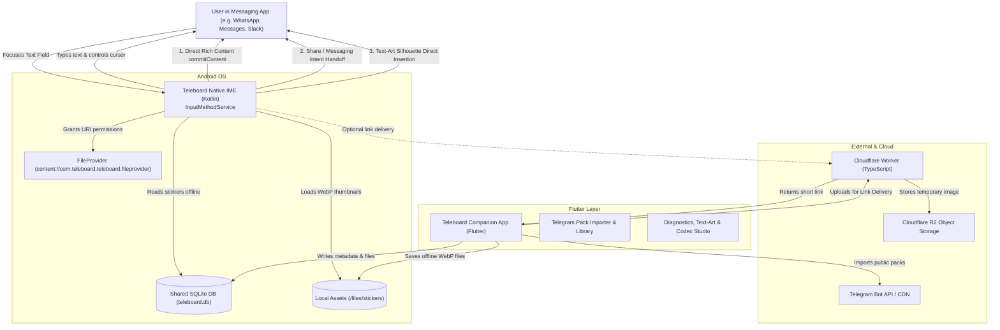

# System Architecture: Teleboard

Teleboard is a privacy-first, minimalist Android keyboard designed around Telegram sticker integration and intelligent universal delivery.

---

## Component Breakdown

### 1. Native Keyboard Layer (`android/app/src/main/kotlin/...`)
- **`TeleboardInputMethodService`**: Core Android `InputMethodService` managing keyboard window lifecycle, input views, text insertion, key events, and cursor movements.
- **`KeyboardLayoutView`**: Native custom ViewGroup providing Apple-inspired minimalist QWERTY, numeric, and symbol layouts with tactile visual feedback.
- **`StickerPickerView`**: Native sticker browser featuring category tabs (Recents, Favorites, Packs), smooth grid scrolling, preview modal, and the prominent **`Send Sticker`** action bar.
- **`SmartDeliveryCoordinator`**: Orchestrates delivery methods (Direct commitContent -> Intent handoff -> Cloudflare link -> SMS chunked transport -> Text-Art fallback).
- **`TeleboardDatabaseHelper`**: Native SQLite helper reading and writing `teleboard.db`.

### 2. Flutter Companion Application (`lib/...`)
- **`features/sticker_packs`**: Telegram pack link parser, Bot API metadata fetcher, asset downloader, and pack library management.
- **`features/stickers`**: Sticker grid, search by emoji/tag, favorite toggles, and recents viewer.
- **`features/delivery`**: Smart delivery test harness, capability detector, and delivery history logs.
- **`features/text_art`**: Interactive text-art previewer and silhouette generator.
- **`features/sms_codec`**: Protocol testing tool for `TELEBOARD_V1` multipart SMS encoding and reassembly.
- **`features/settings`**: Theme selection, Cloudflare Worker endpoint configuration, expiration tuning, and privacy audit.

### 3. Cloudflare Edge Backend (`backend/...`)
- **`Worker`**: TypeScript Hono/Worker application providing `/api/stickers/upload`, `/s/:token` (public HTML viewer and direct image streaming), and `/api/health`.
- **`R2 Storage`**: S3-compatible zero-egress object storage storing encrypted/hashed sticker assets.
- **`Security`**: High-entropy 32-character tokens, rate limiting, and automated 24-hour retention expiration.
