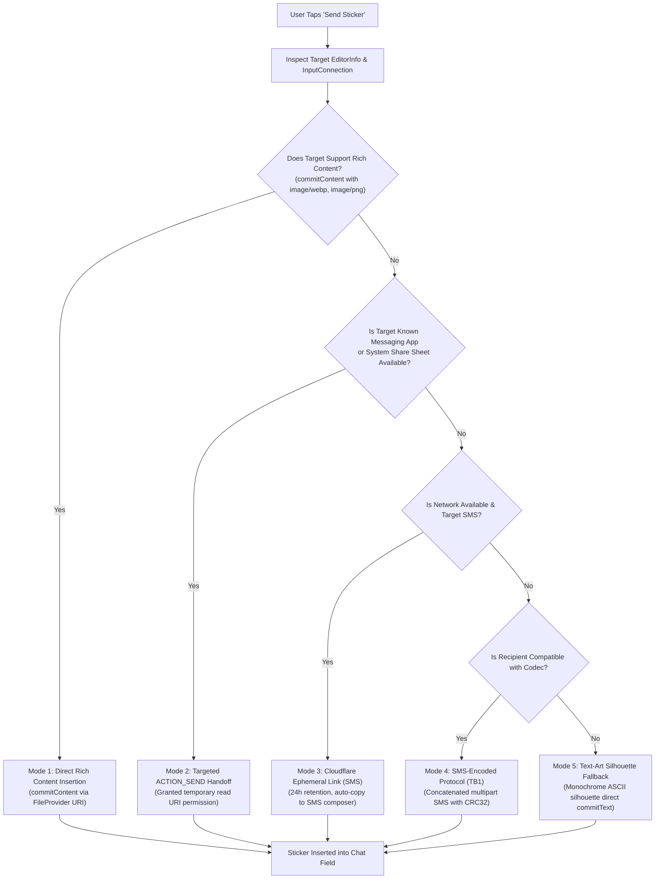

# The Smart Delivery Engine

Teleboard's core interaction model is built around one unified action:

# **`Send Sticker`**

The user never needs to toggle transport protocols, MIME switches, or delivery conduits. The **Smart Delivery Engine** automatically inspects target capabilities and selects the most robust delivery method supported by Android.

---

## 1. Delivery Priority Sequence

---

## 2. Modes Explained

### Mode 1: Direct Rich-Content Insertion (`commitContent`)
- **API**: `androidx.core.view.inputmethod.InputConnectionCompat.commitContent`
- **Capability Check**: `EditorInfoCompat.getContentMimeTypes(editorInfo)`
- **Security**: Content served via `androidx.core.content.FileProvider` (`content://com.teleboard.teleboard.fileprovider/stickers/...`) with `InputConnectionCompat.INPUT_CONTENT_GRANT_READ_URI_PERMISSION`.
- **Supported Applications**: WhatsApp, Google Messages (RCS), Signal, Slack, Discord, Telegram.

### Mode 2: Targeted ACTION_SEND Intent Handoff
- When `commitContent` is unsupported or rejected by an input field (e.g., custom webview chat fields), the engine packages the asset into an `Intent.ACTION_SEND` with `FLAG_GRANT_READ_URI_PERMISSION`.
- Targets the foreground application's package directly (`editorInfo.packageName`) or opens the Android system share sheet.

### Mode 3: Cloudflare Ephemeral Link (SMS Handoff)
- When messaging an SMS recipient without rich content or MMS support:
  1. The asset is uploaded to Cloudflare R2 via the Cloudflare Worker API.
  2. Generates a secure, 32-character URL (`https://<domain>/s/<token>`).
  3. Pre-populates the link in the device's default SMS composer via `Intent.ACTION_SENDTO` with `smsto:` URI.
  4. The recipient opens the link in any mobile browser to view or download the high-resolution sticker.
  5. The link expires automatically after 24 hours.

### Mode 4: SMS-Encoded Protocol (`TELEBOARD_V1`)
- For two compatible Teleboard devices communicating purely over cellular SMS:
  - Envelope: `TB1:<transfer_id>:<part_index>:<total_parts>:<crc32>:<base64url_chunk>`
  - Chunk size: 120 bytes per segment to guarantee delivery within standard SMS concatenation limits.
  - Reassembles parts out-of-order, verifies CRC32 integrity, and rejects corrupted or incomplete sets.

### Mode 5: Text-Art Silhouette Fallback
- When all binary image delivery mechanisms are unavailable:
  - Downsamples the sticker to a 24x12 aspect ratio grid.
  - Detects the transparent alpha boundary to extract the sticker's outline silhouette.
  - Quantizes pixel luminance into dense ASCII typography: `@%#*+=-:. `.
  - Commits the text directly into the active text field via `InputConnection.commitText()`.

---

## 3. Delivery State Machine

| State | Description |
|---|---|
| `idle` | Keyboard is active in text field; sticker picker is browsing. |
| `preparing` | Sticker asset resolved from local disk; MIME type verified. |
| `checkingCapabilities` | Target `EditorInfo` queried for accepted MIME types. |
| `uploading` | Ephemeral link being generated on Cloudflare Worker (Mode 3). |
| `readyToShare` | `FileProvider` URI constructed and read permission prepared. |
| `handingOff` | Intent dispatched to target messaging app or system chooser. |
| `sentToMessagingApp` | `commitContent` accepted by target app or text-art inserted. |
| `deliveryUnknown` | Handoff succeeded, but target app does not emit delivery receipts. |
| `retryableFailure` | Network timeout during Cloudflare link upload; manual retry available. |
| `permanentFailure` | Missing local file asset or target application crashed on intent. |
